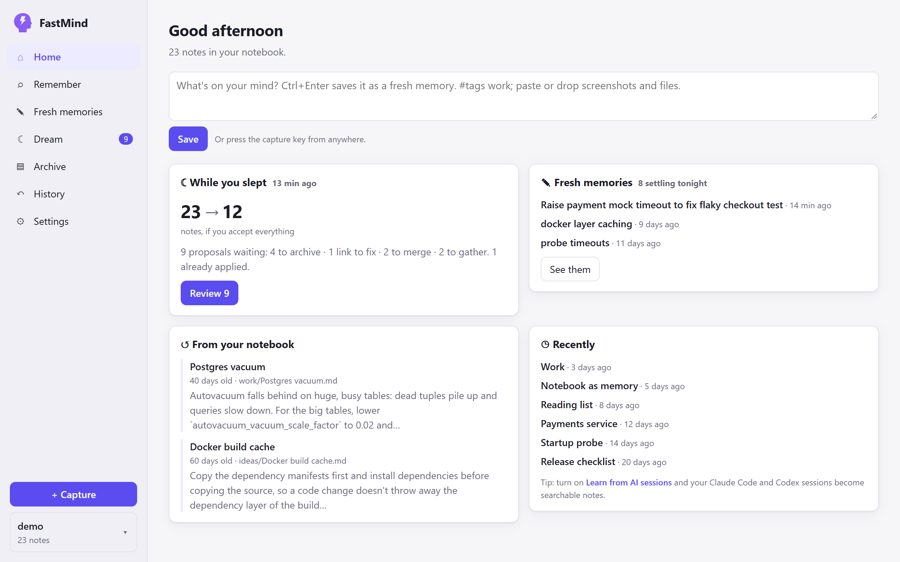
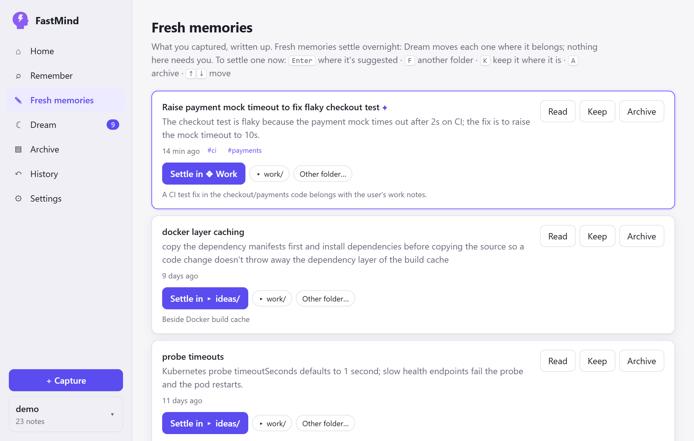

<div align="center">


# FastMind

**Your second brain, kept tidy by AI.**

Never lose a thought or an idea again: one key saves it, and AI turns it into a note
and puts it where it belongs. Overnight it organizes your mind for you, merging, filing and
clearing out. A shared knowledge base for you and your AI.

Plain Markdown files on Windows, macOS and Linux.

[](LICENSE)


[Features](docs/features.md) · [Keys, CLI & settings](docs/reference.md) · [Scenarios](docs/scenarios.md) · [Design](docs/design.md)



</div>

## Why FastMind

| | |
|---|---|
| ⚡ **One key to keep it** | A box opens over whatever you're doing; **Ctrl+Enter** and you're back. The AI writes it up as a finished note. |
| 🌙 **It tidies itself** | At night Dream merges copies, gathers fragments and archives what nothing uses. It proposes; you accept. |
| ↶ **Nothing is lost** | Nothing is deleted, every change goes through a journal, and every change can be undone. |
| 🧠 **Memory for your agents** | Claude Code and Codex search your notes before they dig in, and save what they learn. |
| 📄 **Plain Markdown** | Your notes stay `.md` files, readable by Obsidian, [FastPad](https://github.com/coccor/FastPad) or any editor. No database, no account. |

## Try it

There's no release yet; run it from source (Rust stable):

```sh
cargo run -p fastmind-desktop
```

The first run asks which AI to use, then where your notes are. It finds Obsidian vaults and
[FastCapture](https://github.com/coccor/FastCapture) notebooks, or makes `~/FastMind`. Choose
**Try a demo notebook first** to see Dream work: a messy notebook with 22 notes that Dream
proposes taking down to 10. [Scenarios](docs/scenarios.md) walks through everything.

> [!NOTE]
> FastMind runs on an AI you choose, and won't start without one: **Claude Code** (your Claude
> plan, no API key), the **Claude API** (`ANTHROPIC_API_KEY`), or **a model on your computer**
> (Ollama, LM Studio, llama.cpp), where nothing leaves the machine.

## Features

<table>
<tr>
<td width="50%" valign="top">
<br>
<b>Capture from anywhere</b><br>
Type, paste a screenshot or drop a file. A few seconds later the AI has written it up: title, summary, key points, tasks and links to related notes.
</td>
<td width="50%" valign="top">
<br>
<b>Fresh memories settle on their own</b><br>
Each capture shows where it belongs, and Dream moves it there overnight. Or press <b>Enter</b> to settle it now.
</td>
</tr>
<tr>
<td width="50%" valign="top">
<br>
<b>Remember: search and ask</b><br>
Search everything as you type, typos and all, in about 20 ms. End with <code>?</code> and it answers from your notes, citing each one.
</td>
<td width="50%" valign="top">
<br>
<b>Dream compresses the notebook</b><br>
Merge, gather, archive, fix links, pack. Every proposal carries the AI's reason, and every change can be undone.
</td>
</tr>
</table>

**And also:** your Claude Code and Codex sessions become notes · `/mcp__fastmind__note` in Claude
Code · every job the AI does follows a [skill](docs/features.md#skills-how-the-ai-works) you can
read and edit · a Home page every morning · a `fastmind` command that does everything the app does.

→ **[Read the full feature guide](docs/features.md)**

## Essential keys

| | | | |
|---|---|---|---|
| Capture (anywhere) | `Ctrl+Alt+Space` | Remember (anywhere) | `Ctrl+Alt+R` |
| Save / ask | `Ctrl+Enter` | Settle a fresh memory | `Enter` |
| Edit / save a note | `Ctrl+E` / `Ctrl+S` | Search / capture in the app | `Ctrl+K` / `Ctrl+N` |

On macOS, capture is `Cmd+Option+Space`. All keys, the command line and settings are in the
[reference](docs/reference.md).

## Coding agents

```sh
fastmind agent install
```

That connects Claude Code: the MCP server for every project (`search_notes`, `read_note`,
`ask_notebook`, `save_finding`), `/mcp__fastmind__note` to write up the work, and a `SessionEnd`
hook that writes up each session when it ends. Codex and Claude Desktop use `fastmind mcp`.
[More on agents](docs/features.md#coding-agents).

## FAQ

**Is it free?** Yes: MIT-licensed, no paid tier, no account. The AI is yours: your Claude plan,
your API key, or a model on your computer that costs nothing.

**Does it change my notes without asking?** Only settling fresh memories and packing old archives
run on their own, by default. Everything else is proposed for you to accept, nothing is deleted,
and History undoes any change.

**Can I use it with Obsidian, FastPad or FastCapture?** Yes. It reads and writes the same plain
Markdown folder, and finds Obsidian vaults and FastCapture notebooks on the first run.

**Does anything leave my computer?** What the AI needs goes to the AI you chose; with a local
model, that stays on your computer. FastMind also fetches the pages of links you capture, for
their titles.

## Building from source

You need Rust (stable). On Linux the desktop app also needs WebKitGTK and the tray libraries:

```sh
sudo apt install libwebkit2gtk-4.1-dev libayatana-appindicator3-dev librsvg2-dev libxdo-dev libssl-dev
cargo test --workspace
cargo build --release -p fastmind-desktop -p fastmind-cli
```

Installers come from Tauri's packager (`cargo install tauri-cli --version "^2"` once). It builds
the `fastmind` command first and puts it beside the app, so agents and the session hook can
start it:

```sh
cd apps/desktop
cargo tauri build --config bundle/windows.json   # or bundle/macos.json, bundle/linux.json
# Windows: target/release/bundle/nsis/FastMind_<version>_x64-setup.exe and bundle/msi/*.msi
```

The `bundle/` files are passed only to `cargo tauri build`, because Tauri checks that bundled
files exist on every build.

| Folder | |
|---|---|
| `crates/core` | Notebook, capture, search, answers, Dream, filing, AI sessions, journal, archive. No UI and nothing OS-specific. |
| `crates/cli` | `fastmind`: the terminal, `serve` and `mcp` |
| `apps/desktop` | The tray app (Tauri 2): hotkeys, windows, nightly runs. Its UI is in `apps/desktop/ui`. |

The icon is drawn in `apps/desktop/ui/icon.svg`. After changing it, run
`cargo tauri icon ui/icon.svg -o <scratch folder>` in `apps/desktop`, copy the files that
`tauri.conf.json` lists into `icons/`, and `64x64.png` over `icons/tray.png`.

## Contributing & license

Found a bug? [Open an issue](https://github.com/coccor/FastMind/issues). If FastMind saves you
time, **[star it on GitHub](https://github.com/coccor/FastMind)**.

Released under the [MIT License](LICENSE).
