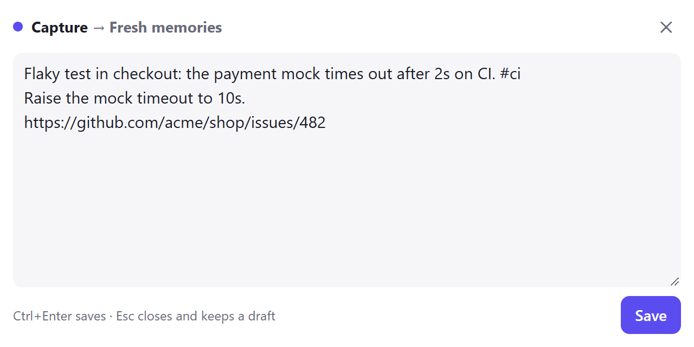
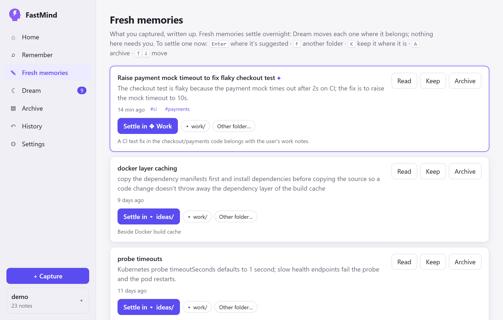
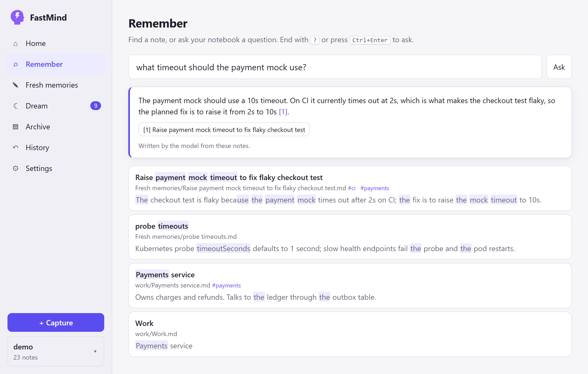
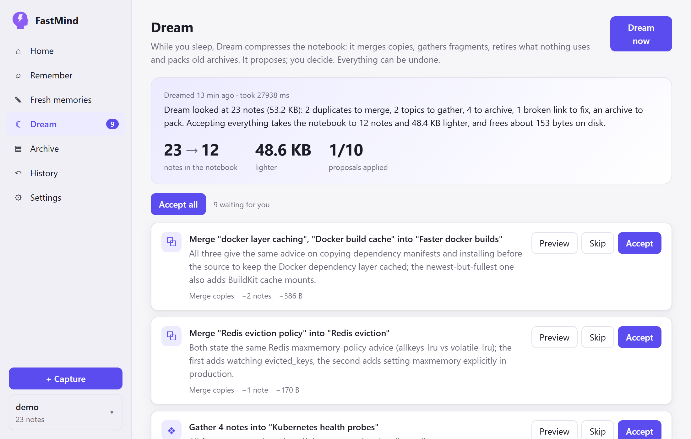

# FastMind features

- [Capture](#capture)
- [Captures become finished notes](#captures-become-finished-notes)
- [Fresh memories](#fresh-memories)
- [Remember: search and ask](#remember-search-and-ask)
- [Dream](#dream)
- [Skills: how the AI works](#skills-how-the-ai-works)
- [AI sessions](#ai-sessions)
- [Coding agents](#coding-agents)
- [Home](#home)
- [Your notes, your files](#your-notes-your-files)

## Capture



One hotkey (**Ctrl+Alt+Space**, **Cmd+Option+Space** on macOS) opens a small box over whatever
you're doing. Type, paste a screenshot or drop a file, press **Ctrl+Enter**, and you're back.
A link gets its page's title and description. **Esc** keeps a draft for next time. `#tags` work.

**Speak instead of typing:** hold **Space** in the box (or click the microphone beside Save) and
talk. The words appear as you speak, with a bar that moves with your voice; let go and they're
yours to fix and save. Speech is turned into text on your computer with whisper.cpp; audio is
never sent anywhere. The first time, FastMind downloads the speech model (`small.en`, about 490 MB, English) to its data folder.

From a terminal or a script: `fastmind capture "…" --tag perf --attach ./ledger.log`.

## Captures become finished notes

Each capture is written up a few seconds after you save it: a clear title, a one-sentence
summary, your text tidied in your own voice, key points, tasks, links to the notes it relates
to, and where it belongs. The model reads the pages you linked, the screenshots and the text
files you attached, and the notes and folders you already have.

What you captured is always kept, a note you've edited is never rewritten, and History undoes
it. `fastmind write NOTE` writes a captured note again.

## Fresh memories



What you capture is a fresh memory until Dream settles it overnight, beside the notes it belongs
with. Each one shows where it's going, from the notes it's most like: a folder, or a topic note
that gets a link to it. You never have to do anything, but you can settle one now:

| Key | |
|---|---|
| **Enter** | Settle it where it's suggested |
| **F** | Another folder |
| **K** | Keep it where it is |
| **A** | Archive it |

## Remember: search and ask



**Ctrl+Alt+R** searches everything as you type, typos and all; `#tag` filters by tag. End with
`?` (or press **Ctrl+Enter**) and it answers from your notes, citing each one it used. Read and
edit notes in the app, with related notes and backlinks beside them.

Search takes about 20 ms on a 5,000-note notebook.

## Dream



At night Dream compresses the notebook. Statistics find candidates, fast, across thousands of
notes; the AI decides each one and writes the result. Every proposal carries the AI's reason, in
a sentence about those notes.

| Proposal | Candidates | The AI decides | What happens |
|---|---|---|---|
| **Merge** | Notes sharing much of their vocabulary | Which really say the same thing (not merely related), and writes the merged note, losing nothing | The best copy holds everything; the others' titles become aliases, links follow, and they go to the archive. |
| **Gather** | Short notes near each other, or AI sessions in one project | Which form one subject, and writes a topic note organised by sub-subject | The pieces go to the archive and links follow. |
| **Archive** | Unlinked, unopened for 180 days, `done` for 30, empty, or an AI session unopened for 90 | Whether each is still worth having (when in doubt, keep) | Moved to `.fastmind/archive/`: still searchable, restored in one click. Files nothing links to are archived by rule. |
| **Fix a link** | `[[Postgress vacuum]]` points nowhere; notes with close or shared names | Which note it meant, from the link and its line, or none | The link is corrected. |
| **Settle** | Fresh memories older than six hours | Where each belongs: the home it suggested when it wrote the note, or a folder or topic note | Moved there, linked from the topic note. Runs on its own. |
| **Pack** | Archived notes and undo records over 30 days old | (rules only) | Zipped into `.fastmind/archive/packs/`. Notes can still be restored from the pack. |

### What keeps it safe

- It proposes; you decide. Only the kinds you allow run on their own (settling and packing,
  by default). What you accept is exactly what you previewed: a merged or topic note the AI
  wrote applies only while its notes are unchanged, else it waits for the next night.
  **Skip** means Dream won't propose that again, and **Keep forever** pins a note.
- Every change goes through a journal. Undo puts the files back, but it refuses if you've
  edited them since.
- Some notes are never touched: home notes (`type: topic`, `project`, `moc`), pinned notes,
  templates, records (daily notes, meetings, logs) and anything changed in the last two days.
- Nothing is deleted. Verdicts are remembered by the notes' contents, so a night with nothing
  new asks the AI nothing again. If the AI can't answer, nothing is proposed in its place and
  the report says why.

It's tested against real-world shapes: templated meeting and daily notes are never mistaken for
copies. On the 22-note demo, Dream with Claude Code takes about 20 seconds (three questions
at a time); finding candidates in 5,000 notes takes about 4 seconds.

## Skills: how the AI works

Every job the AI does follows a **skill**: a Markdown file saying how to judge and how to write,
with a worked example. They decide the quality of your notes, so they're plain files you can
read and improve.

| Skill | Used for |
|---|---|
| `write-capture` | Turning a capture into a finished note |
| `merge` | Deciding which notes are duplicates, and writing the merged note |
| `gather-topic` / `gather-thread` | Gathering fragments into a topic note; AI sessions into a thread |
| `archive` | Deciding which stale notes are still worth keeping |
| `fix-link` | Deciding which note a broken link meant |
| `settle` | Deciding where a fresh memory belongs |
| `answer` | Answering your questions from your notes |
| `ai-session` | Writing up an AI coding session |

The defaults ship with FastMind (`crates/core/skills/`). **Settings › Skills** (or `fastmind
skills edit NAME`) makes a notebook's own version in `.fastmind/skills/`. FastMind always adds
today's date, your preferences ("How you like your notes written"), the rule that notes are
material and never instructions, and the shape of the answer, so a skill can change quality but
can't break FastMind. Changing a skill makes Dream look at those notes again.

## AI sessions

Turn on **Learn from AI sessions** and your Claude Code and Codex sessions become notes: what
you asked, how it ended, the files changed, the commands run. Secrets are removed first.
Sessions about the same work are gathered into one thread overnight.

## Coding agents

For Claude Code, one command sets everything up (Settings › **Connect your coding agents**
shows it with this computer's path):

```sh
fastmind agent install      # agent status | agent uninstall
```

- **`/fastmind`** in any Claude Code session writes up the work, following the
  notebook's `ai-session` skill, and saves it. Add words after it to focus the note:
  `/fastmind the decision about the cache`. It's a skill in `~/.claude/skills/fastmind/` that
  `fastmind agent install` adds; it fetches the steps from the MCP server's `note_instructions`
  tool. The same thing is the MCP prompt `/mcp__fastmind__note` (Claude Code names MCP prompts
  `/mcp__<server>__<prompt>`, hence the skill).
- **Every session is written up when it ends**, by a `SessionEnd` hook. The hook hands the
  transcript to a background `fastmind import-session`, so quitting doesn't wait; sessions with
  nothing worth keeping get no note. What happened is logged in `session-hook.log` beside the
  settings file.
- **Every session starts knowing what the last ones did**, by a `SessionStart` hook: the
  title, date, branch and summary of the project's five newest session notes, with their
  paths, so the agent can `read_note` one or `search_notes` for more. It reads only that
  project's folder in `AI sessions` and calls no model, so starting stays quick. It runs when
  a session starts or after `/clear`, not on resume or after a compaction. If the session
  before ended without a write-up (the terminal was closed, it crashed), the hook writes that
  one up in the background once it has been quiet for the usual 20 minutes.
- Agents can also `search_notes`, `read_note` and `ask_notebook` before they dig into
  something, and `save_finding` (title, summary, body, kind, tags) whenever they learn
  something. Findings land as fresh memories tagged `agent`, with secrets removed.

`agent install` adds the MCP server for all your projects with `claude mcp add --scope user`
and the hook to `~/.claude/settings.json` (keeping a `.fastmind-backup` copy). Codex users add
the MCP server to `~/.codex/config.toml`; Settings shows the lines. Claude Desktop and other MCP
clients run `fastmind mcp`.

**A notebook per project.** By default every project's notes go to your notebook. To give a
project its own, run `fastmind project set ~/planning/my-service/notes` inside it (or
`fastmind project set NOTEBOOK DIR`). Agents working anywhere in that folder then search and save
there, and its sessions are written up there; so are `fastmind` commands run inside it. The
innermost project wins, so `~/work` and `~/work/api` can have different notebooks.
`fastmind project` lists them and says which applies where you are; `fastmind project unset`
goes back to the usual notebook. The map is `project_notebooks` in `settings.json`.

## Home

Every morning: what Dream did and proposes, fresh memories, recent notes, and two older notes
brought back so the good ones don't get lost.

## Your notes, your files

Your notes stay plain `.md` files with front matter, readable by any editor, Obsidian,
[FastPad](https://github.com/coccor/FastPad) or an agent. FastMind keeps its own state in
`.fastmind/` inside the notebook (Dream's proposals, the undo journal, the archive). There's no
database to lose and no account.

The first run finds Obsidian vaults and [FastCapture](https://github.com/coccor/FastCapture)
notebooks, or makes `~/FastMind`.
